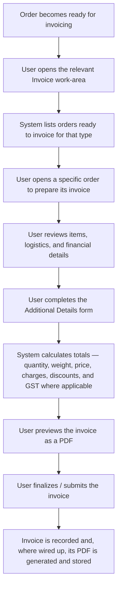
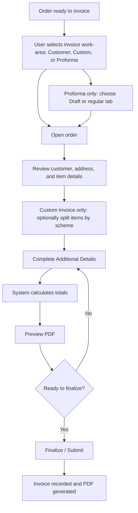
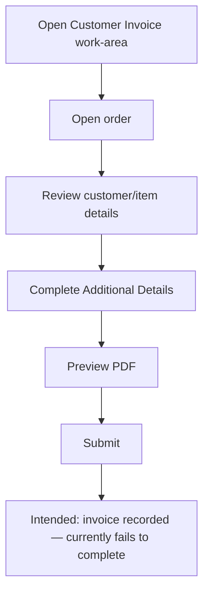
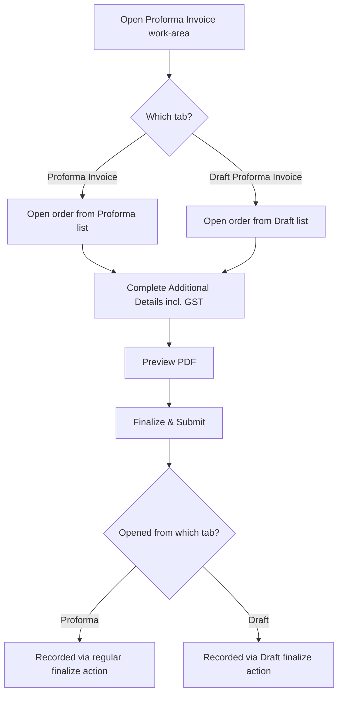
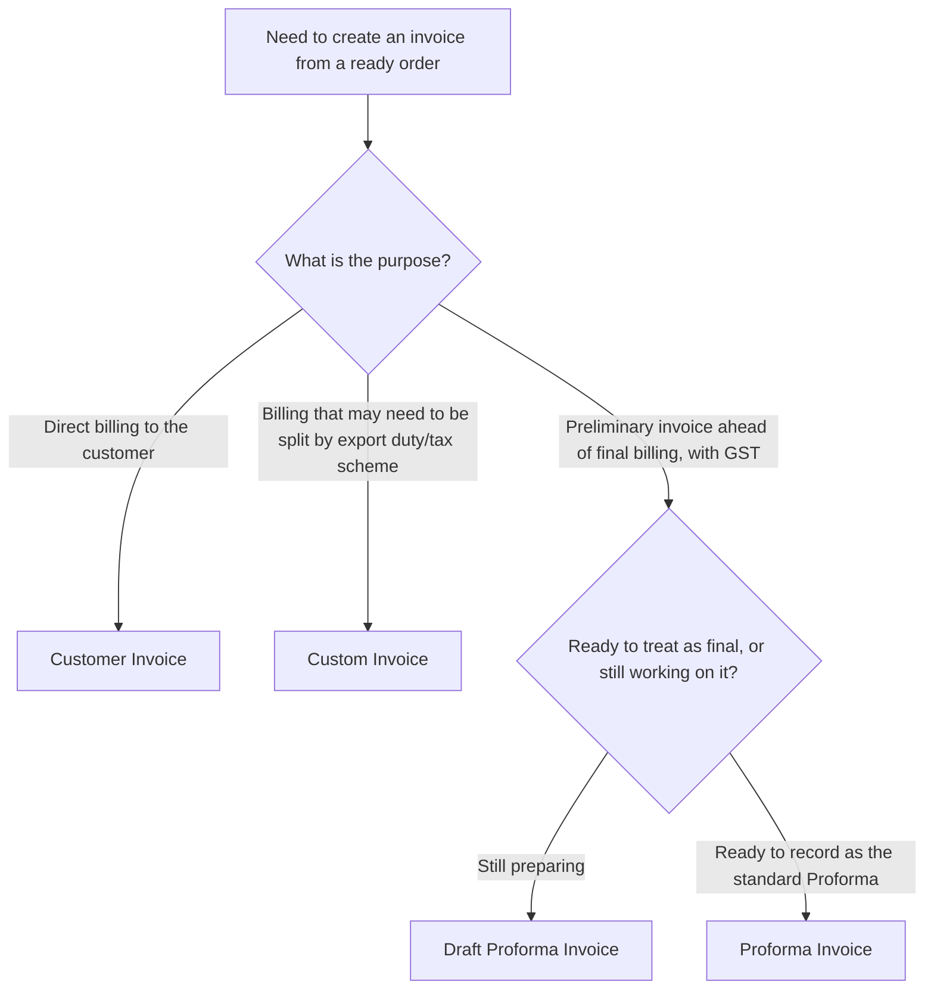

# Invoice Management Module

## Business Requirements & Functional Requirements Document

---

## 1. Document Control

### Document Information

| Item | Details |
|---|---|
| Document Name | Invoice Management Module – BRD & FRD |
| Module | Invoice (International – Customer Invoice, Custom Invoice, Proforma Invoice, Draft Proforma Invoice) |
| Version | 1.0 |
| Document Type | Business & Functional Requirements |
| Prepared From | Existing application implementation (source-code inspection) |
| Status | Draft |
| Date | 2026-08-18 |

**Note on source:** This document was produced entirely by inspecting the implemented application. No business owner, project name, or company identity beyond what appears in the system itself (e.g., document footer text referencing exporting legal entities) has been assumed. Where a business detail could not be confirmed in the implementation, this document says so explicitly rather than filling the gap.

---

## 2. Executive Summary

The Invoice module supports the process of turning a completed sales order into a billing or pre-billing document for export customers. It is used once an order has progressed far enough (dispatch/production has marked it ready) that the business needs to either bill the customer formally or issue a preliminary document ahead of shipment.

The module supports **three genuinely different invoicing workflows**, not four as commonly assumed:

1. **Customer Invoice** — a straightforward billing document prepared directly from a ready order, for a defined customer.
2. **Custom Invoice** — the same underlying billing concept, but built to allow one order to be split into several invoices, each governed by a different export duty/tax scheme (e.g., Advance Licence, MOOWR, DDB).
3. **Proforma Invoice** — a preliminary invoice, generated before the final customer invoice, that additionally supports GST calculation. This workflow has two operating modes — **"Proforma Invoice"** and **"Draft Proforma Invoice"** — which are the same business process with two separate work-lists, not two different document types.

There is **no functionality in the system that converts one invoice type into another** — a Proforma Invoice does not automatically become a Customer Invoice, and a Draft Proforma does not get "promoted" into a finalized Proforma. Each is created and finalized independently.

The expected business outcome of the module is a finalized invoice document (with its accompanying PDF, ready for the customer) plus, for Customer and Custom Invoices, a record submitted to the backend for downstream billing processes.

---

## 3. Business Objective

Based on the confirmed implementation, the Invoice module exists to let authorized users:

- Retrieve orders that have been marked ready for invoicing, per invoice type.
- Prepare a Customer Invoice for a specific customer directly from such an order.
- Prepare a Custom Invoice from such an order, with the ability to split the order across multiple export schemes when required.
- Prepare a Proforma Invoice (including a "Draft" working version) ahead of final billing, including GST calculation.
- Capture supporting invoice information: logistics/shipping details, banking details, payment terms, additional charges, and discounts.
- Calculate invoice totals — quantity, weight, price, applicable charges/discounts, and (Proforma only) GST.
- Generate a printable/downloadable PDF representation of the invoice.
- Restrict which invoice types a given user can see and act on, based on assigned permissions.

The following commonly expected ERP capabilities were **not confirmed** in the implementation and must not be assumed to exist: a multi-step approval workflow, invoice cancellation, invoice deletion, payment tracking (paid/unpaid/outstanding balance), or automatic conversion between invoice types. These are called out explicitly in the relevant sections below rather than omitted silently.

---

## 4. Scope

### 4.1 In Scope

- Creating a Customer Invoice from a ready order.
- Creating a Custom Invoice from a ready order, including splitting the order by export scheme.
- Creating a Proforma Invoice, in either "Proforma" or "Draft Proforma" mode.
- Entering and reviewing invoice header information (dates, logistics, payment terms, bank details).
- Reviewing invoice line items (already populated from the order — not manually added).
- Applying additional charges and discounts.
- Calculating GST for Proforma Invoices (IGST, or CGST+SGST, or a backend-supplied default).
- Previewing and generating a PDF of the invoice.
- Restricting access to each invoice type by user permission.
- Distinguishing between a "not yet finalized" invoice (fields still editable) and a "prepared" invoice (certain fields locked and charges capped) for Customer and Proforma Invoices.

### 4.2 Out of Scope (not implemented, or not confirmed)

- **Editing individual line items** — quantities, prices, and product details on an invoice line come from the source order and are not manually typed by the invoice user (Custom Invoice allows splitting an item's quantity across schemes, which is a different operation from editing).
- **Adding brand-new line items** to an invoice that aren't already on the source order.
- **Removing line items** from an invoice.
- **Deleting or cancelling an invoice** of any type — no such function was found.
- **Multi-step approval workflow** (e.g., submit → review → approve/reject) — no such function was found for any invoice type.
- **Converting a Proforma Invoice into a Customer or Custom Invoice.**
- **Converting/"promoting" a Draft Proforma Invoice into a finalized Proforma Invoice** — each is created independently.
- **Tax calculation for Customer Invoice or Custom Invoice** — no tax/GST computation was found in either of these two workflows; GST is confirmed only within the Proforma Invoice workflow.
- **Payment tracking** — no paid amount, outstanding balance, or payment status fields were found.
- **Email delivery, Excel export, or CSV export of invoices** — only PDF generation/download was found.
- **A separate "View" (read-only) screen** — viewing an existing invoice opens the same screen used to prepare/edit it.

---

## 5. Users / Actors

The system does not define named business roles (e.g., "Sales User," "Finance User") for the Invoice module. Access is instead controlled by two mechanisms confirmed in the implementation: an **Administrator** override, and a set of **named permissions**, one per invoice work-area, that must be explicitly granted to a user.

| Actor | Responsibility | Invoice Actions |
|---|---|---|
| **Administrator** | Full access to the system, bypasses all permission checks. | Can access and act on all four invoice work-areas (Customer, Custom, Proforma, Draft Proforma) without restriction. |
| **User granted "Customer Invoice" access** | Prepares and submits Customer Invoices. | Can view the Customer Invoice list, prepare, and (attempt to) submit Customer Invoices. |
| **User granted "Custom Invoice" access** | Prepares and submits Custom Invoices, including scheme splitting. | Can view the Custom Invoice list, prepare, split by scheme, and submit Custom Invoices. |
| **User granted "Proforma Invoice" access** | Prepares Proforma Invoices. | Can view and act on the Proforma Invoice work-list. |
| **User granted "Draft Proforma Invoice" access** | Prepares Draft Proforma Invoices. | Can view and act on the Draft Proforma work-list. |

**Not confirmed:** a dedicated "Approver" role, a "Finance" role, or any role with rights narrower than full access to a given invoice work-area once granted (e.g., there is no "view only" vs. "can submit" distinction within a granted permission — anyone with access to a work-area can perform every action available there, including final submission).

---

## 6. High-Level Business Process



This reflects the actual sequence found across all three workflows. The order itself — how it is created, and how it becomes "ready to invoice" — happens **before** this module and is outside the Invoice module's own code (no order-entry logic was found here; the module only *consumes* orders already marked ready).

---

## 7. Complete Invoice Lifecycle

```text
Order marked "ready to invoice" (outside this module)
   ↓
User opens the invoice work-area and sees the list of ready orders
   ↓
User opens a specific order — its Prepare screen loads
   ↓
User reviews Customer/Party and Address details (read-only, drawn from the order)
   ↓
User reviews the item list (read-only; Custom Invoice additionally allows splitting quantities by scheme)
   ↓
User opens "Additional Details" and enters logistics, banking, payment terms, charges, discounts (and GST, for Proforma)
   ↓
System calculates Subtotal → (Charges − Discounts) → [GST, Proforma only] → Grand Total
   ↓
User previews the generated PDF
   ↓
User finalizes / submits
   ↓
Once submitted, the invoice becomes "Prepared" — certain fields (invoice number, and for Customer Invoice, packing details) become read-only, and charge/discount totals are capped at the amount already recorded
   ↓
Completed
```

**Stage-by-stage detail:**

| Stage | Who performs it | Information entered | Validation | On failure |
|---|---|---|---|---|
| Order listing | Any user with access to that invoice type | None — read-only list, searchable/filterable | None | List simply shows no/fewer results |
| Open order | Same user | Selects a row | System checks the user's permission for that invoice type before allowing entry | Access blocked with an on-screen message if permission is missing |
| Review Customer/Item details | Same user | None — display only | None | N/A |
| Split by scheme (Custom Invoice only) | Same user | Split quantity, target scheme | Split quantity must be a whole number, greater than zero, and less than the item's full quantity; a scheme other than "Direct" must be chosen | On-screen error message; split is not applied |
| Additional Details | Same user | Logistics, address, banking, payment terms, charges, discounts, (GST for Proforma) | Required-field checks; for charges, once "Prepared," the total cannot exceed the amount already on record | Form will not save until required fields are completed / cap is not exceeded |
| Preview PDF | Same user | None | The system requires the Additional Details step to be completed first before finalizing can proceed | Finalize option stays hidden until this is done |
| Finalize / Submit | Same user | Confirms via a dialog | See §20 | Confirmed failures show an on-screen error and the invoice is not recorded as finalized |

---

## 8. Invoice Type Overview

| Feature | Customer Invoice | Custom Invoice | Proforma Invoice | Draft Proforma Invoice |
|---|---|---|---|---|
| Business Purpose | Direct billing document for a customer, prepared from a ready order | Billing document that can be split across multiple export duty/tax schemes | Preliminary invoice, issued ahead of final billing, with GST calculation | Working/preliminary version of a Proforma Invoice, tracked in its own list |
| Used By | Users granted Customer Invoice access | Users granted Custom Invoice access | Users granted Proforma Invoice access | Users granted Draft Proforma Invoice access |
| Customer Required | Yes — order already carries the customer | Yes — order already carries the customer | Yes — order already carries the customer | Yes — same as Proforma |
| Item Required | Yes — items come from the order | Yes — items come from the order; may be split by scheme | Yes — items come from the order | Yes — same as Proforma |
| Pricing | Quantity × (unit price [+ rim price if applicable]) | Same, calculated per scheme-split invoice | Same, plus GST-aware totals | Same as Proforma |
| Tax | Not confirmed / not implemented | Not confirmed / not implemented | Yes — GST (IGST or CGST+SGST, or a backend-provided default) | Yes — same GST calculation as Proforma |
| Status | "Prepared" once submitted (fields lock) | No lock/status behavior confirmed | "Prepared" once submitted (fields lock) | Same status concept as Proforma |
| Editable | Yes, until "Prepared"; certain fields remain locked after | Yes — no confirmed lock after submission | Yes, until "Prepared" | Same as Proforma |
| Printable | Yes | Yes | Yes | Yes |
| PDF | Two-page document (invoice + packing list), always | One-page combined document, or a two-page Sri Lanka–specific variant depending on the shipping plant | Single-page document | Same template as Proforma; only the on-screen preview label differs ("Draft" vs. the normal title) |
| Finalization | **Submission does not complete successfully in the current implementation** (see §31) | Submission is fully functional | Submission is fully functional | Submission is fully functional |
| Conversion | Not applicable | Not applicable | Not confirmed — no conversion to Customer/Custom Invoice found | Not confirmed — no promotion to a finalized Proforma found; Draft and Proforma are each submitted independently |

---

## 9. Customer Invoice — Functional Flow

### 9.1 Purpose

To produce a direct billing invoice for a customer once their order is ready to be invoiced.

### 9.2 Preconditions

- An order exists and has been marked ready to invoice (a status set before this module is reached — the marking process itself is outside the Invoice module).
- The requesting user has been granted Customer Invoice access.

### 9.3 Creation Flow

```text
Open Customer Invoice work-area
        ↓
System lists orders ready for Customer invoicing
        ↓
User opens a specific order
        ↓
System displays customer, billing/shipping address, and item details (read-only, from the order)
        ↓
User opens "Additional Details" and enters logistics, banking, payment terms, and any charges/discounts
        ↓
System calculates totals
        ↓
User previews the PDF
        ↓
User submits
```

### 9.4 User Actions

Search/filter the ready-order list · open an order · view customer, address, and item details · fill in the Additional Details form · reset the Additional Details form back to previously recorded values · preview the PDF · submit. **Not available:** add/remove/edit a line item, cancel, delete.

### 9.5 Business Rules

- Charges cannot exceed the amount already on record once the invoice is "Prepared."
- Pallet and wooden-box packing quantities cannot exceed the total item quantity.
- The Submit action only becomes available once the Additional Details form has been completed and the PDF has been previewed at least once.

### 9.6 Expected Result

In principle, a completed submission creates the customer invoice record and produces its PDF for download. **In the current implementation, this final step does not complete successfully** — see §31 for details. Business stakeholders should treat Customer Invoice finalization as not currently working and confirm the intended behavior with the technical team before relying on it.

---

## 10. Custom Invoice — Functional Flow

### 10.1 Purpose

To produce one or more billing invoices from a single order, where portions of the order fall under different export duty/tax schemes (e.g., "Advance Licence," "MOOWR," "Duty Drawback," "Import Invoice," or no scheme at all — "Direct").

### 10.2 How it differs from Customer Invoice (business terms)

Customer Invoice treats the whole order as one invoice. Custom Invoice additionally lets the user decide, item by item, whether a quantity should be split off and billed under a specific export scheme. Each scheme produces its own invoice number, and each requires its own scheme-specific supporting details (e.g., licence number and licence date) before it can be finalized. Custom Invoice also supports orders that ship from multiple plants combined into one shipment ("Combi" orders), showing quantity/weight/price totals grouped by plant.

### 10.3 Creation Flow

```text
Open Custom Invoice work-area
        ↓
System lists orders ready for Custom invoicing
        ↓
User opens a specific order
        ↓
User decides: bill the whole order directly, or split it by scheme
        ↓
If splitting: user selects a scheme and enters the quantity to split off, per item
        ↓
System validates the split (quantity must be whole, greater than zero, less than the item's full quantity, and a real scheme must be chosen)
        ↓
User opens "Additional Details" — enters logistics, banking, payment terms, per-scheme licence details, packing details, charges/discounts
        ↓
System calculates totals per resulting invoice (one per scheme, plus one for anything left "Direct")
        ↓
User previews the PDF
        ↓
User submits
```

### 10.4 User Actions

Search/filter the list · open an order · toggle between "Direct" and "Scheme" invoicing · select a scheme and split a quantity · fill Additional Details (including per-scheme licence info) · preview PDF · submit. **Not available:** add/remove a line item, cancel, delete.

### 10.5 Business Rules

- A split quantity must be a whole number, greater than zero, and less than the item's original quantity.
- A split requires a scheme other than "Direct" to be selected.
- Schemes other than "Direct," "Import Invoice," and "Duty Drawback" require a licence number and licence date before the Additional Details form can be completed.
- When the order currency is not INR, an exchange rate must be provided.
- Each scheme-split invoice receives its own sequential invoice number.

### 10.6 Save / Status / PDF / Print / Edit / Cancel

Submission calls through to the backend and, on success, automatically generates and uploads the invoice PDF — this path is confirmed working end-to-end. No "locked after submission" behavior was found for Custom Invoice (unlike Customer Invoice's "Prepared" lock). No cancel/delete function was found.

---

## 11. Proforma Invoice — Functional Flow

### Purpose

To produce a preliminary invoice ahead of final billing/shipment — typically used to communicate expected charges, including GST, to the customer before the transaction is finalized.

### Preconditions

Same as Customer Invoice: an order must be marked ready to invoice (specifically, ready under the Proforma work-list), and the user must be granted Proforma Invoice access.

### Creation Flow

```text
Open Proforma Invoice work-area
        ↓
User chooses the "Proforma Invoice" tab (or the "Draft Proforma Invoice" tab — see §12)
        ↓
System lists ready orders for the chosen tab
        ↓
User opens a specific order
        ↓
System displays customer, address, and item details (read-only, from the order)
        ↓
User opens "Additional Details" — enters logistics, banking, payment terms, notify-party details, charges/discounts, and GST
        ↓
System calculates Subtotal → Charges/Discounts → Taxable Amount → GST → Grand Total
        ↓
User previews the PDF
        ↓
User finalizes and submits
```

### Required Information

Logistics (pre-carriage method, final destination, container type), exporter address and signatory, buyer's order number, order/email dates, incoterm and place of incoterm, payment terms, bank details, lead time, validity date, and — where applicable — notify-party details, GST type and rate.

### Item Selection

Items are drawn from the order and displayed read-only. A "Part Number" reference can optionally be entered against each item when that feature is enabled for the record being viewed. No item add/remove/quantity-split capability exists in this workflow (unlike Custom Invoice).

### Pricing / Tax

Line pricing follows the same quantity × unit-price logic as the other invoice types. Tax is calculated as GST: the user selects whether it is IGST, a combined CGST+SGST, or a backend-supplied default, and the system computes a taxable amount (subtotal plus charges minus discounts) and the resulting GST and grand total.

### Validation

Most Additional Details fields are required (see §20 and §33). GST percentage entries are restricted to 0–100. Packing quantities are balance-validated against the item's total quantity, same as the other flows.

### Save / Status

The Additional Details entries are held locally until the user finalizes; nothing is sent to the backend until the Finalize/Submit action. After submission, records marked "Prepared" have their charge/discount totals capped at the amount already on record.

### Edit / Print / PDF

Editable up to submission, subject to the "Prepared" cap described above. PDF preview is available at any point once the item list has loaded; the printed document itself always displays the title "Proforma Invoice," regardless of whether the record was worked on via the "Proforma" or "Draft Proforma" tab — only the on-screen preview page label distinguishes the two.

### Conversion

**Conversion functionality was not identified in the available implementation.** No functionality exists to turn a Proforma Invoice into a Customer Invoice, a Custom Invoice, or any other document type.

---

## 12. Draft Invoice — Functional Flow

**Important clarification confirmed during analysis:** "Draft Invoice" is not a separate invoice type in this system. It is the second of two tabs/work-lists within the **Proforma Invoice** work-area — "Draft Proforma Invoice" and "Proforma Invoice" are the same screens, the same form, and the same PDF document, differing only in (a) which work-list an order appears in, and (b) which of two finalize actions is used when the user submits. There is no independent "Draft Invoice" module, list, or record type outside of this.

```text
User opens the Proforma Invoice work-area and selects the "Draft Proforma Invoice" tab
        ↓
System lists orders in the Draft work-list
        ↓
User opens a specific order — the same Prepare screen used for regular Proforma Invoices loads
        ↓
User enters/reviews the same information described in §11
        ↓
User previews the PDF (viewer label reads "Draft" instead of the normal title; the PDF document body itself still reads "Proforma Invoice")
        ↓
User finalizes — the system records it via the Draft-specific finalize action
```

- **Why drafts exist:** to give users a separate work-list for Proforma Invoices that are still being prepared, distinct from the list of invoices considered ready/normal Proforma.
- **What can be saved / edited:** identical to the regular Proforma workflow — no Draft-specific field restrictions were found.
- **What cannot be edited:** same "Prepared" locking behavior as regular Proforma, where applicable.
- **How a draft is reopened:** by opening it from the Draft Proforma Invoice list, the same way any Proforma record is opened.
- **How a draft becomes final:** **it does not automatically become a finalized Proforma Invoice.** Finalizing a record from the Draft tab records it through a Draft-specific action; finalizing a record from the Proforma tab records it through a separate, regular action. These are two independent outcomes, not a two-step promotion of the same record.
- **What happens if the user cancels:** **Not confirmed** — no cancel/delete function was found for Draft (or regular) Proforma records.
- **Whether drafts can be deleted:** **Not confirmed** — no delete function was found.

---

## 13. Screen-by-Screen Functional Description

### Screen: Customer/Custom Invoice — Ready Orders List

- **Purpose:** Lists orders ready to be invoiced, for either Customer or Custom Invoice, switchable via an on-screen toggle.
- **Who Can Access:** Users with Customer Invoice and/or Custom Invoice permission.
- **Entry Point:** Invoice menu, under the applicable invoice type.
- **Main Sections:** Search box, column filter, results table, per-row "Open" action.
- **Fields:**

  | Field | Description | Required | User Action | Business Meaning |
  |---|---|---|---|---|
  | Customer | Order's customer name | N/A (display) | View | Identifies who the invoice is for |
  | Order Ref No | The originating order's reference | N/A | View / search | Traceability back to the order |
  | Order Date | Date the order was completed | N/A | View / filter | Reference date |
  | Dispatched Date | Desired ship date | N/A | View / filter | Logistics planning reference |
  | RFD Date | Ready-for-dispatch date | N/A | View / filter | Logistics planning reference |
  | Shipment Type | e.g., standard or combined ("Combi") shipment | N/A | View | Determines whether the Combi grouping view is shown later |
  | Final Loading At | The plant the shipment loads from | N/A | View | Also determines which PDF template/legal entity text is used |
  | Qty / FWT | Total quantity / total finished weight | N/A | View | Quick order-size reference |

- **Buttons / Actions:**

  | Action | Purpose | Preconditions | Result |
  |---|---|---|---|
  | Toggle Customer/Custom | Switches which list is shown | User must hold the relevant permission | Loads the other invoice type's ready-order list |
  | Open (row action) | Opens the order's Prepare screen | User must hold the relevant permission | Navigates to Customer or Custom Prepare screen depending on the active toggle |

- **Validation:** Toggle is blocked with an on-screen message if the user lacks permission for the target type.
- **Navigation:** Refreshing this page or arriving via a bookmark, without going through the toggle first, can leave the list without a selected type — this is a known limitation (§31).

### Screen: Customer Invoice — Prepare

- **Purpose:** Review order/customer/item details and complete the information required to finalize a Customer Invoice.
- **Who Can Access:** Users with Customer Invoice permission.
- **Entry Point:** "Open" from the ready-orders list (Customer mode).
- **Main Sections:** Order/customer summary card, item table, "Additional Details" entry point, Submit action.
- **Buttons / Actions:**

  | Action | Purpose | Preconditions | Result |
  |---|---|---|---|
  | Fill/Edit Mandatory Fields | Opens the Additional Details form | None | Modal opens |
  | Preview PDF | Generates a PDF preview | None | Navigates to the PDF viewer; also enables the Submit button |
  | Submit | Finalizes the invoice | Additional Details completed and PDF previewed | Intended to record the invoice and produce its PDF — **does not currently complete successfully** (§31) |

### Screen: Custom Invoice — Prepare

- **Purpose:** Same as above, plus scheme-splitting and Combi-order grouping.
- **Who Can Access:** Users with Custom Invoice permission.
- **Main Sections:** Order/customer summary card, item table with split controls, global scheme selector, Combi Orders table (shown only for combined shipments), Additional Details entry point, Submit action.
- **Buttons / Actions:** Split (per item), Fill/Edit Mandatory Fields, Preview PDF, Submit (finalizes and — on success — automatically uploads the PDF).

### Screen: Proforma / Draft Proforma Invoice — List

- **Purpose:** Lists orders ready for Proforma or Draft Proforma invoicing, one list per tab.
- **Who Can Access:** Users holding the relevant tab's permission; a tab is hidden entirely if the user lacks its permission.
- **Main Sections:** Page title, search box, tab bar (Draft Proforma Invoice / Proforma Invoice), results table, "Open" action.

### Screen: Proforma Invoice — Prepare

- **Purpose:** Review and complete information required to finalize a Proforma or Draft Proforma Invoice.
- **Main Sections:** Order/customer summary card, item table (with optional Part Number entry), Additional Details entry point, Finalize & Submit action (with confirmation dialog).
- **Buttons / Actions:**

  | Action | Purpose | Preconditions | Result |
  |---|---|---|---|
  | Fill Additional Details | Opens the GST-aware Additional Details form | None | Modal opens |
  | Preview PDF | Generates a PDF preview | None | Navigates to the PDF viewer |
  | Finalize & Submit | Finalizes the invoice | Additional Details completed and PDF previewed | Confirmation dialog, then records the invoice via the Draft or regular Proforma action depending on which tab was used to open it |

### Screen: Additional Details (all three types)

- **Purpose:** Capture the logistics, financial, and (for Proforma) tax information required before an invoice can be finalized.
- **Main Sections:** Logistics, address/authorisation, financial terms, additional charges, discounts, packing (Customer/Custom), GST (Proforma only).
- **Validation:** Required-field checks per §20/§33; charge totals capped once "Prepared"; packing quantities balance-checked against total item quantity.
- **Success Behavior:** Saves the entered information for use in totals/PDF; does not itself submit the invoice.

### Screen: PDF Preview (all three types)

- **Purpose:** Shows the generated invoice document before final submission.
- **Main Sections:** Full invoice document — company/exporter details, buyer/consignee, shipping details, item table, totals, terms, signature block.
- **Navigation:** "Back" returns to the relevant Prepare screen.

---

## 14. Invoice Header Information

| Field | Business Meaning |
|---|---|
| Invoice Number | The document's identifying number. Editable before finalization; read-only afterward (Customer Invoice, Proforma Invoice). For Custom Invoice, each scheme-split portion of an order gets its own sequential invoice number. |
| Order Ref No / Buyer's Order Number | Links the invoice back to the originating sales order/customer PO reference. |
| Invoice Date / Order Date | Reference dates shown on the invoice and used in the ready-orders list. |
| Currency | The transaction currency for the order; drives amount and currency-symbol display, and whether an exchange rate must be provided. |
| Incoterm / Place of Incoterm | The agreed delivery/risk-transfer term (e.g., FOB, CIF, DDP) and the location it applies at. |
| Payment Terms | Free-text terms of payment shown on the invoice. |
| Bank Details | The exporter's banking information to be shown on the invoice, either entered manually or selected from a maintained list (Proforma). |
| Container / Shipment details | Vessel/flight number, bill of lading number, port of loading/discharge, container type/number/seal number — logistics information shown on the document. |
| Lead Time / Validity Date | (Proforma only) How long the quoted terms remain valid. |
| GST fields | (Proforma only) Selected tax type and resulting percentage/amount. |

**Not confirmed as present:** a distinct "Legal Entity" selector field, a "Due Date" field, or a "Credit Days" field within the Invoice module itself (the exporting company/legal-entity identity is instead implied by the shipping plant, which also determines which legal-entity name is printed on the PDF).

---

## 15. Customer / Billing / Shipping Information

Customer, billing, and shipping information is **automatically populated from the underlying order** — the invoice user does not search for or select a customer from a master list within this module; it arrives already attached to the order once opened. This information (company name, address, city, country, postal code, contact name, email, phone) is displayed read-only in the order/customer summary card on every Prepare screen.

A separate **Notify Party** block (name, address, city/state/country, email, phone) can be entered manually where applicable — this represents a third party (distinct from the buyer) to be notified about the shipment, common in export documentation.

No direct interaction with a Customer Master screen was found within the Invoice module — customer data is consumed as part of the order record, not looked up independently.

---

## 16. Item / Line Item Functionality

```text
Item arrives already attached to the order
   ↓
System displays: product/tyre description, quantity, unit price, weight
   ↓
(Custom Invoice only) User may split a portion of the quantity into a separate scheme-based invoice
   ↓
(Proforma only) User may optionally record a Part Number reference against the item
   ↓
System calculates the line's price and weight contribution to the invoice totals
```

- **Item is added:** Not a user action — items are inherited from the order in full when the Prepare screen loads.
- **Item is edited:** Not supported — no field on an item (quantity, price, product detail) is user-editable, other than the scheme-split operation described for Custom Invoice and the optional Part Number entry in Proforma.
- **Item is removed:** Not supported.
- **Quantity changes:** Only via a scheme split (Custom Invoice), which creates a separate sub-invoice for the split portion — it does not change the original item's quantity on the invoice.
- **Price/tax/discount changes:** Not applied at the individual item level in any of the three flows — charges, discounts, and (Proforma) tax are applied at the whole-invoice level, not per line.
- **Duplicate item handling:** No de-duplication logic was found; items are shown exactly as they exist on the order.

---

## 17. Pricing and Calculation Flow

```text
Item Quantity
   ×
Unit Price (tyre price, plus rim price when the item includes a rim)
   ↓
Line Amount
   ↓
Sum of all Line Amounts = Subtotal
   ↓
+ Additional Charges  − Discounts
   ↓
Taxable Amount  (Proforma only)
   ↓
+ GST  (Proforma only — IGST, or CGST+SGST, or a backend-provided rate)
   ↓
Final Invoice Amount
```

A parallel calculation runs for **weight** (unit weight × quantity, summed, plus packing weight where applicable) to support the packing-list portion of the document. For Customer Invoice and Custom Invoice, there is no confirmed tax step — the Final Invoice Amount for those two types is Subtotal plus Charges minus Discounts, with no GST/tax line. Custom Invoice additionally computes these totals **separately for each scheme-split portion** of the order, since each becomes its own invoice.

**Amount in Words:** the invoice total is also expressed in words on the printed document, in the transaction currency.

---

## 18. Tax Functionality

Tax handling was confirmed **only within the Proforma Invoice workflow** (which, per §12, also covers the "Draft Proforma Invoice" tab). No tax/GST calculation was found in the Customer Invoice or Custom Invoice workflows — this should not be assumed to be an oversight in this document; it reflects what the implementation actually does.

Within Proforma Invoice:

- The user chooses a GST mode: **IGST**, **CGST + SGST**, or a system default sourced from the order record ("Backend").
- If IGST is chosen, the user enters an IGST percentage (0–100).
- If CGST+SGST is chosen, the user enters both percentages separately (0–100 each).
- If the default mode is used, the applicable percentages come from the order record itself rather than manual entry.
- GST is calculated on the **taxable amount** (subtotal plus charges minus discounts), not on the raw subtotal.
- The resulting GST amount is added to the taxable amount to produce the final total.

No other tax types (VAT, state-specific tax beyond CGST/SGST, or country-based tax switching) were found.

---

## 19. Discount and Charges

All three invoice types support **Additional Charges** and **Discounts**, entered at the whole-invoice level (not per item):

- **Customer Invoice / Custom Invoice:** charges and discounts are grouped per scheme (for Custom) or per the invoice's existing charge record (for Customer), with up to three named charge slots and three named discount slots.
- **Proforma Invoice:** charges are chosen from a fixed list of categories — Surcharge, Pallet Charges, Freight Charges, Fumigation, Wrapping Charges, Brand Plate Making Charges, Tariff — and discounts from Discount or Claim Adjustment. Any number of charge/discount rows can be added.
- Once an invoice is "Prepared," the total of additional charges cannot exceed the amount already recorded for it.

**Not confirmed:** a dedicated "Freight" or "Insurance" field outside of Proforma's charge-category list, or a distinct "Round Off" adjustment on any invoice type — no rounding-adjustment line item was found anywhere in the module.

---

## 20. Validation & Business Rules

### Mandatory Validation

| Rule | Applies To | Trigger | User Message | Business Impact |
|---|---|---|---|---|
| Logistics/financial fields required (pre-carriage method, incoterm, place of incoterm, payment terms, etc.) | All three types (fields vary slightly per type — see §9.5/§10.5/§11) | Saving the Additional Details form | Inline "required" messages | Form will not save until satisfied |
| GST percentage 0–100 | Proforma | Entering IGST/CGST/SGST values | Inline range message | Value rejected outside range |

### Data Validation

| Rule | Applies To | Trigger | User Message | Business Impact |
|---|---|---|---|---|
| Split quantity must be a whole number, > 0, and less than the item's full quantity | Custom Invoice | Attempting a scheme split | On-screen error toast | Split not applied |
| Pallet/wooden-box tyre counts cannot exceed total item quantity (individually or combined) | Customer, Custom, Proforma | Entering packing quantities | Inline validation | Value rejected/capped |

### Business Validation

| Rule | Applies To | Trigger | User Message | Business Impact |
|---|---|---|---|---|
| A split requires a real scheme (not "Direct") | Custom Invoice | Attempting a scheme split | On-screen error toast | Split not applied |
| Non-Direct schemes require licence number/date before Additional Details can be saved | Custom Invoice | Saving Additional Details | Inline required message | Form incomplete until provided |
| Exchange rate required when currency is not INR | Custom Invoice | Saving Additional Details | Inline required message | Form incomplete until provided |
| Charges cannot exceed the amount already on record once "Prepared" | Customer Invoice, Proforma Invoice | Editing charges after preparation | On-screen error toast | Excess entry rejected |

### Status Validation

| Rule | Applies To | Trigger | User Message | Business Impact |
|---|---|---|---|---|
| Invoice number and packing fields become read-only once "Prepared" | Customer Invoice | Reopening a prepared invoice | Fields shown as read-only | Prevents changing already-recorded values |
| Submit/Finalize button hidden until Additional Details is complete and PDF has been previewed | Customer Invoice, Custom Invoice, Proforma Invoice | Attempting to finalize early | Button not shown | Prevents premature finalization |

---

## 21. Invoice Status Flow

Only one confirmed status-like value exists in the implementation: **"Prepared"** — applied to Customer Invoice and Proforma Invoice once the invoice has previously been finalized/recorded. No broader set of statuses (e.g., Draft → Submitted → Approved → Posted → Paid) was found.


| Status | Meaning | Who can create it | Who can change it | Allowed actions | Restricted actions | Next possible status |
|---|---|---|---|---|---|---|
| Not yet Prepared | The invoice's Additional Details have not yet been finalized/submitted | Any user with access to the invoice type | Same | Full editing of all fields | Finalize is unavailable until Additional Details is complete | Prepared |
| Prepared | The invoice has previously been finalized/submitted | System, upon successful submission | Not user-changeable from the UI | View, and edit of remaining unlocked fields | Invoice number and packing fields (Customer Invoice) become read-only; charges capped at the recorded amount | None confirmed — no further status transition was found |

The **"Draft" / "Proforma"** distinction (§12) is a **document classification / work-list choice**, not a position in this status flow — a record does not move from "Draft" status to "Proforma" status; it is simply worked on and finalized within whichever tab it was opened from.

---

## 22. Approval Workflow

**No approval workflow was identified in the available implementation.** There is no submit-for-review step, no reviewer/approver role, and no approve/reject action anywhere in the Invoice module. Once a user with access to an invoice type completes the required information, they can finalize it directly.

---

## 23. Editing Rules

| Invoice Status | Editable | Editable Fields | Restricted Fields |
|---|---|---|---|
| Not yet Prepared (any type) | Yes | All Additional Details fields | None |
| Prepared — Customer Invoice | Partially | Most Additional Details fields | Invoice number; packing (pallet/wooden-box) fields |
| Prepared — Proforma / Draft Proforma Invoice | Partially | Most Additional Details fields | Additional charges total capped at the recorded amount |
| Any — Custom Invoice | Yes | No lock behavior was found for Custom Invoice after submission | Not confirmed |

Line items themselves are never directly editable in any status, in any invoice type (see §16).

---

## 24. Cancel / Delete Functionality

**No cancel or delete functionality was found for any of the three invoice workflows.** There is no button, confirmation dialog, or backend call in the code that removes, voids, or cancels an invoice once it has been opened or finalized. If this capability is required by the business, it does not currently exist in the implementation and should be raised as a new requirement rather than assumed to be present.

---

## 25. PDF / Print Business Flow

```text
Invoice Data (order + Additional Details + calculated totals)
   ↓
Invoice Document is generated in-browser
   ↓
Preview screen shows the full document
   ↓
User downloads or (on successful submission, Customer/Custom Invoice) the system automatically stores the PDF
```

**Content shown on the printed document (common to all three types):** exporter/company details, buyer/consignee details, shipping/notify-party details (where provided), logistics information (vessel, ports, container), the item table, subtotal, additional charges and discounts, grand total, the amount in words, payment terms, bank details, standard declaration text, and a signatory block.

**Differences between invoice types:**

- **Customer Invoice** always produces a two-page document — an invoice page (priced) and a packing-list page (weights).
- **Custom Invoice** produces a single combined "invoice cum packing list" page by default, or a two-page document using a Sri Lanka–specific layout when the shipment originates from a Sri Lanka plant. The document title also changes to a "Re-Export" variant when the invoice falls under the Import Invoice scheme.
- **Proforma / Draft Proforma Invoice** produces a single document that additionally shows the GST calculation. The document body always reads "Proforma Invoice," regardless of whether it was prepared from the Draft or the regular tab — only the on-screen preview page (not the printed document) shows a "Draft" label.

**Signatory/legal-entity text:** the printed signatory line names the exporting legal entity, chosen based on the shipping plant on the order.

---

## 26. Error and Exception Flow

```text
User enters invalid or incomplete data
   ↓
System shows an inline validation message
   ↓
User corrects the data
   ↓
User attempts to save/submit again
```

```text
User submits the invoice
   ↓
The system encounters a problem communicating with the backend
   ↓
An on-screen error notification is shown
   ↓
The invoice is not recorded as finalized — the user remains on the Prepare screen
```

The system also shows on-screen notifications for broader session issues (e.g., the user's session having expired), which will redirect the user to sign in again; and for cases where the user attempts an action they don't have permission for. These are handled the same way across the whole application, not specifically for invoices.

---

## 27. User Journeys

### Customer Invoice User Journey

```text
User opens the Invoice module
        ↓
Selects the Customer Invoice work-area
        ↓
Opens an order from the ready list
        ↓
Reviews the pre-filled customer and item details
        ↓
Completes the Additional Details form
        ↓
Reviews the calculated total
        ↓
Previews the PDF
        ↓
Submits the invoice
        ↓
(Intended) Invoice recorded and PDF available — currently does not complete, see §31
```

### Custom Invoice User Journey

```text
User opens the Invoice module
        ↓
Selects the Custom Invoice work-area
        ↓
Opens an order from the ready list
        ↓
Decides whether to split the order by scheme
        ↓
Splits relevant items and assigns schemes, if needed
        ↓
Completes the Additional Details form, including scheme-specific licence details
        ↓
Reviews the calculated totals per resulting invoice
        ↓
Previews the PDF
        ↓
Submits the invoice
        ↓
Invoice(s) recorded and PDF automatically generated/stored
```

### Proforma Invoice User Journey

```text
User opens the Invoice module
        ↓
Selects the Proforma Invoice work-area, "Proforma Invoice" tab
        ↓
Opens an order from the ready list
        ↓
Reviews the pre-filled customer and item details
        ↓
Completes the Additional Details form, including GST selection
        ↓
Reviews the calculated total (including GST)
        ↓
Previews the PDF
        ↓
Finalizes and submits the invoice
```

### Draft Proforma Invoice User Journey

```text
User opens the Invoice module
        ↓
Selects the Proforma Invoice work-area, "Draft Proforma Invoice" tab
        ↓
Opens an order from the Draft list
        ↓
Completes the same Additional Details form used for regular Proforma
        ↓
Previews the PDF (viewer shows a "Draft" label)
        ↓
Finalizes and submits the invoice via the Draft-specific action
```

---

## 28. End-to-End Business Scenarios

### Scenario: Create Customer Invoice

- **Actor:** User with Customer Invoice access.
- **Preconditions:** At least one order is ready for Customer invoicing.
- **Steps:** Open work-area → open order → complete Additional Details → preview PDF → submit.
- **Expected Result:** *Intended* to record the invoice — **in the current implementation, submission fails** (§31).
- **Alternate Flow:** User previews the PDF multiple times before submitting.
- **Exception Flow:** Required field left blank — form does not save; user is shown which fields are missing.

### Scenario: Create Custom Invoice (no split)

- **Actor:** User with Custom Invoice access.
- **Preconditions:** An order ready for Custom invoicing, to be billed as a single "Direct" invoice.
- **Steps:** Open work-area → open order → complete Additional Details → preview PDF → submit.
- **Expected Result:** Invoice recorded, PDF generated and stored.
- **Exception Flow:** Backend error on submit — on-screen error shown, invoice not recorded.

### Scenario: Create Custom Invoice (with scheme split)

- **Actor:** User with Custom Invoice access.
- **Preconditions:** Order with items eligible to be split across schemes.
- **Steps:** Open order → switch to Scheme mode → split relevant item quantities and assign schemes → complete Additional Details including licence details per scheme → preview PDF → submit.
- **Expected Result:** Multiple invoices recorded, one per scheme (plus one for any remaining "Direct" quantity), each with its own invoice number.
- **Exception Flow:** Attempting to split more than the item's full quantity, a non-whole number, or without selecting a real scheme — on-screen error, split rejected.

### Scenario: Create Proforma Invoice

- **Actor:** User with Proforma Invoice access.
- **Steps:** Open work-area → "Proforma Invoice" tab → open order → complete Additional Details including GST → preview PDF → finalize and submit.
- **Expected Result:** Proforma Invoice recorded via the regular finalize action.

### Scenario: Save / Work on a Draft Proforma Invoice

- **Actor:** User with Draft Proforma Invoice access.
- **Steps:** Open work-area → "Draft Proforma Invoice" tab → open order → complete Additional Details → preview PDF.
- **Expected Result:** Details are held for the session; nothing is recorded to the backend until Finalize & Submit is used.

### Scenario: Finalize a Draft Proforma Invoice

- **Steps:** From the Draft tab, complete the record and use Finalize & Submit.
- **Expected Result:** Recorded via the Draft-specific finalize action. **Does not become, or get linked to, a regular Proforma Invoice record** — it remains its own Draft-originated record.

### Scenario: Edit an already-Prepared Customer Invoice

- **Steps:** Reopen a Prepared Customer Invoice → attempt to change the invoice number or packing quantities.
- **Expected Result:** Those fields are shown read-only and cannot be changed; other fields remain editable, subject to the charge cap.

### Scenario: Print / Download an Invoice PDF

- **Steps:** From any Prepare screen, use "Preview PDF."
- **Expected Result:** The full invoice document is displayed for review/download, matching the content described in §25 for that invoice type.

### Scenario: Validation failure — missing required field

- **Steps:** Attempt to save Additional Details with a required field (e.g., Payment Terms) left blank.
- **Expected Result:** Form does not save; the missing field is flagged inline.

### Scenario: Validation failure — invalid split quantity

- **Steps:** On Custom Invoice, enter a split quantity greater than or equal to the item's full quantity.
- **Expected Result:** On-screen error message; the split is not applied.

**Scenarios explicitly not created (functionality not found):** cancelling an invoice, deleting an invoice, approving/rejecting an invoice, converting a Proforma Invoice into a Customer/Custom Invoice, or promoting a Draft Proforma Invoice into a finalized Proforma Invoice — none of these exist in the implementation.

---

## 29. Business Flow Diagrams

### Overall Invoice Flow



### Customer Invoice Flow



### Custom Invoice Flow

```mermaid
flowchart TD
    A[Open Custom Invoice work-area] --> B[Open order]
    B --> C{Split by scheme?}
    C -->|No| D[Complete Additional Details]
    C -->|Yes| E[Select scheme and split quantity per item]
    E --> D
    D --> F[Preview PDF]
    F --> G[Submit]
    G --> H[Invoice(s) recorded, PDF generated automatically]
```

### Proforma / Draft Proforma Invoice Flow



### Status Lifecycle


### Approval Flow

**Not applicable** — no approval workflow exists in the implementation (see §22).

---

## 30. Functional Requirements

| Requirement ID | Functional Requirement | Actor | Priority | Expected Behavior |
|---|---|---|---|---|
| FR-INV-001 | The system shall allow a user with Customer Invoice access to view orders ready for Customer invoicing. | Customer Invoice user | High | List of ready orders is shown, searchable/filterable |
| FR-INV-002 | The system shall allow a user with Customer Invoice access to open a ready order and prepare a Customer Invoice from it. | Customer Invoice user | High | Prepare screen loads with order/customer/item details |
| FR-INV-003 | The system shall require the Additional Details form to be completed before a Customer Invoice can be submitted. | Customer Invoice user | High | Submit control hidden until complete |
| FR-INV-004 | The system shall calculate the Customer Invoice total from item quantity, price, additional charges, and discounts. | System | High | Totals shown before submission |
| FR-INV-005 | The system shall generate a two-page PDF (invoice and packing list) for a Customer Invoice. | System | High | PDF available for preview/download |
| FR-INV-006 | The system shall lock the invoice number and packing fields on a Customer Invoice once it is "Prepared." | System | Medium | Fields shown read-only |
| FR-INV-007 | The system shall allow a user with Custom Invoice access to view orders ready for Custom invoicing. | Custom Invoice user | High | List shown |
| FR-INV-008 | The system shall allow a user with Custom Invoice access to split an order's items across export duty/tax schemes. | Custom Invoice user | High | Split creates a separate invoice per scheme |
| FR-INV-009 | The system shall validate that a split quantity is a whole number, greater than zero, and less than the item's full quantity. | System | High | Invalid splits rejected with a message |
| FR-INV-010 | The system shall require a valid scheme (other than "Direct") to be selected before a split can be applied. | System | High | Split rejected without a scheme |
| FR-INV-011 | The system shall require a licence number and licence date for schemes other than Direct, Import Invoice, and Duty Drawback. | System | High | Additional Details form cannot be saved without these |
| FR-INV-012 | The system shall require an exchange rate for Custom Invoices where the order currency is not INR. | System | Medium | Additional Details form cannot be saved without it |
| FR-INV-013 | The system shall calculate totals separately for each scheme-split invoice resulting from a Custom Invoice order. | System | High | Each split shows its own totals and invoice number |
| FR-INV-014 | The system shall submit a Custom Invoice to the backend and, on success, automatically generate and store its PDF. | System | High | Confirmed end-to-end for Custom Invoice |
| FR-INV-015 | The system shall group Custom Invoice items by plant and show combined totals when the order is a "Combi" (multi-plant) shipment. | System | Medium | Combi Orders table shown |
| FR-INV-016 | The system shall allow a user with Proforma Invoice access to view orders ready for Proforma invoicing, separated into "Proforma" and "Draft Proforma" work-lists. | Proforma / Draft Proforma user | High | Two tabs, each independently permission-gated |
| FR-INV-017 | The system shall allow the user to select a GST mode (IGST, CGST+SGST, or a backend-provided default) for a Proforma Invoice. | Proforma user | High | Mode selection changes which fields are entered |
| FR-INV-018 | The system shall calculate GST on the taxable amount (subtotal plus charges minus discounts) for a Proforma Invoice. | System | High | GST and grand total shown |
| FR-INV-019 | The system shall restrict GST percentage entries to a 0–100 range. | System | Medium | Out-of-range values rejected |
| FR-INV-020 | The system shall finalize a Proforma Invoice using a different backend action depending on whether it was opened from the "Draft" or "Proforma" tab. | System | High | No cross-tab promotion occurs |
| FR-INV-021 | The system shall cap additional charges at the amount already recorded once an invoice (Customer or Proforma) is "Prepared." | System | Medium | Excess charge entries rejected |
| FR-INV-022 | The system shall restrict access to each invoice work-area (Customer, Custom, Proforma, Draft Proforma) based on the user's granted permissions, with a full-access override for Administrators. | System | High | Unpermitted work-areas/tabs are hidden or blocked |
| FR-INV-023 | The system shall generate a downloadable/previewable PDF for every invoice type. | System | High | PDF content matches §25 |
| FR-INV-024 | The system shall display validation messages for incomplete or invalid Additional Details entries and prevent saving until resolved. | System | High | Inline messages shown |
| FR-INV-025 | The system shall display an on-screen error and leave the invoice unfinalized if a submission fails to complete. | System | High | User remains on the Prepare screen |

---

## 31. Non-Functional Observations

- **Data integrity:** Once "Prepared," certain financial fields are protected from being changed beyond what was already recorded — a control aimed at preventing accidental overstatement after an invoice has been recorded.
- **Auditability:** No audit trail (who changed what, when) was found within the Invoice module itself.
- **Usability:** The same Prepare screen is reused for creating and reopening an invoice, which keeps the interface consistent but means there is no distinct read-only "view" experience.
- **Known limitation — Customer Invoice finalization:** in the current implementation, submitting a Customer Invoice does not complete successfully. This should be confirmed with the technical team before Customer Invoice is relied on for production billing; it is flagged here as a business-impacting observation, not a code detail.
- **Known limitation — page refresh (Customer/Custom list):** if a user refreshes the Customer/Custom Invoice list page directly (rather than navigating via the toggle), the list may not know which invoice type to show.
- **No performance, availability, or security SLA figures were found or should be assumed** — none are invented here.

---

## 32. Business Rules Register

| Rule ID | Business Rule | Applies To | Description |
|---|---|---|---|
| BR-INV-001 | A split quantity must be a whole number greater than zero and less than the item's full quantity. | Custom Invoice | Prevents splitting an item's entire quantity or an invalid amount |
| BR-INV-002 | A split requires a scheme other than "Direct." | Custom Invoice | Ensures splits are only used for genuine scheme-based billing |
| BR-INV-003 | Schemes other than Direct, Import Invoice, and Duty Drawback require a licence number and date. | Custom Invoice | Reflects the documentation required for licensed export schemes |
| BR-INV-004 | Non-INR orders require an exchange rate on Custom Invoice. | Custom Invoice | Ensures currency conversion is captured for reporting |
| BR-INV-005 | Each scheme-split invoice receives its own sequential invoice number. | Custom Invoice | Keeps split invoices individually identifiable |
| BR-INV-006 | Once "Prepared," additional charges cannot exceed the amount already recorded. | Customer Invoice, Proforma Invoice | Prevents inflating charges after initial recording |
| BR-INV-007 | Once "Prepared" (Customer Invoice), the invoice number and packing fields become read-only. | Customer Invoice | Protects already-recorded identifying/packing data |
| BR-INV-008 | Pallet and wooden-box packing quantities cannot exceed the item's total quantity, individually or combined. | Customer, Custom, Proforma | Ensures packing figures reconcile with the shipped quantity |
| BR-INV-009 | GST is calculated on the taxable amount (subtotal plus charges minus discounts), not the raw subtotal. | Proforma Invoice | Standard tax-on-net-amount treatment |
| BR-INV-010 | GST percentages must fall between 0 and 100. | Proforma Invoice | Prevents invalid tax entries |
| BR-INV-011 | A Draft Proforma Invoice and a regular Proforma Invoice are recorded via separate finalize actions; no automatic promotion occurs. | Proforma / Draft Proforma Invoice | Confirms these are two independent outcomes |
| BR-INV-012 | Access to each invoice work-area is governed by a specific permission per type/tab, with Administrators exempt. | All | Controls who can see and act on each invoice type |
| BR-INV-013 | Submit/Finalize is only available once Additional Details is complete and the PDF has been previewed at least once. | Customer, Custom, Proforma Invoice | Ensures the user has reviewed the document before finalizing |

---

## 33. Validation Requirements Register

| Validation ID | Validation | Trigger | Expected Result |
|---|---|---|---|
| VAL-INV-001 | Required logistics/financial fields (varies per type — see §9.5/§10.5/§11) | Saving Additional Details | Form blocked from saving until complete |
| VAL-INV-002 | Split quantity is a whole number, > 0, and < item's full quantity | Attempting a scheme split (Custom Invoice) | Split rejected with an on-screen message |
| VAL-INV-003 | A real scheme (not "Direct") is selected for a split | Attempting a scheme split (Custom Invoice) | Split rejected |
| VAL-INV-004 | Licence number/date present for applicable schemes | Saving Additional Details (Custom Invoice) | Form blocked from saving |
| VAL-INV-005 | Exchange rate present when currency is not INR | Saving Additional Details (Custom Invoice) | Form blocked from saving |
| VAL-INV-006 | GST percentage between 0 and 100 | Entering GST values (Proforma Invoice) | Out-of-range value rejected |
| VAL-INV-007 | Pallet/wooden-box quantities do not exceed total item quantity | Entering packing quantities | Value rejected/capped |
| VAL-INV-008 | Additional charges total does not exceed the recorded amount once "Prepared" | Editing charges (Customer, Proforma) | Excess entry rejected |
| VAL-INV-009 | User holds the required permission for the invoice type/tab being accessed | Opening a work-area, tab, or toggle | Access blocked with an on-screen message |

---

## 34. User Action Matrix

| Action | Customer Invoice | Custom Invoice | Proforma Invoice | Draft Proforma Invoice |
|---|---|---|---|---|
| Create | Yes (attempted; submission does not complete — §31) | Yes | Yes | Yes |
| View | Yes | Yes | Yes | Yes |
| Edit | Yes, until "Prepared" | Yes | Yes, until "Prepared" | Yes, until "Prepared" |
| Delete | Not found | Not found | Not found | Not found |
| Cancel | Not found | Not found | Not found | Not found |
| Submit | Yes (does not complete successfully) | Yes | Yes | Yes |
| Approve | Not found | Not found | Not found | Not found |
| Print | Yes | Yes | Yes | Yes |
| PDF | Yes | Yes | Yes | Yes |
| Convert (to/from another invoice type) | Not found | Not found | Not found | Not found |

---

## 35. Invoice Type Decision Flow



- **Customer Invoice** is used when the order is to be billed directly to the customer with no need to split it by export scheme.
- **Custom Invoice** is used when portions of the order fall under different export duty/tax schemes and must be billed as separate invoices, or when the order needs the additional packing/licence documentation this workflow supports.
- **Proforma Invoice** is used to issue a preliminary, GST-aware invoice ahead of final billing.
- **Draft Proforma Invoice** is used for the same purpose while the record is still being worked on, kept in its own list until finalized.

---

## 36. QA / Testing Reference

| Test ID | Scenario | Preconditions | Steps | Expected Result |
|---|---|---|---|---|
| TC-INV-001 | Open Customer Invoice ready-orders list | User has Customer Invoice access, at least one ready order exists | Navigate to Customer Invoice | List of ready orders is shown |
| TC-INV-002 | Attempt Customer Invoice toggle without permission | User lacks Customer Invoice permission | Attempt to toggle to Customer view | Access blocked with an on-screen message |
| TC-INV-003 | Complete and submit a Customer Invoice | Ready order open in Prepare | Fill Additional Details, preview PDF, submit | Currently: submission fails with an error (document actual result against §31 during test execution) |
| TC-INV-004 | Reopen a "Prepared" Customer Invoice | A previously submitted Customer Invoice exists | Reopen it | Invoice number and packing fields are read-only |
| TC-INV-005 | Split a Custom Invoice item with an invalid quantity | Order open in Custom Invoice Prepare, Scheme mode active | Enter a split quantity ≥ the item's full quantity | Error message shown; split not applied |
| TC-INV-006 | Split a Custom Invoice item without selecting a scheme | Same as above | Attempt split with scheme left as "Direct" | Error message shown; split not applied |
| TC-INV-007 | Complete a valid Custom Invoice scheme split and submit | Same as above, valid split performed | Complete Additional Details incl. licence info, preview PDF, submit | Invoice recorded, PDF generated and stored |
| TC-INV-008 | Submit a Custom Invoice order without splitting | Ready order open, Direct mode | Complete Additional Details, preview PDF, submit | Invoice recorded, PDF generated and stored |
| TC-INV-009 | Enter a GST percentage outside 0–100 on Proforma Invoice | Proforma Additional Details open | Enter e.g. 150 in an IGST field | Value rejected/flagged |
| TC-INV-010 | Complete and submit a Proforma Invoice | Ready order open, "Proforma Invoice" tab | Complete Additional Details incl. GST, preview PDF, finalize & submit | Invoice recorded via the regular Proforma action |
| TC-INV-011 | Complete and submit a Draft Proforma Invoice | Ready order open, "Draft Proforma Invoice" tab | Complete Additional Details, preview PDF, finalize & submit | Invoice recorded via the Draft-specific action; no linkage to a regular Proforma record is created |
| TC-INV-012 | Attempt to exceed the packing quantity balance | Additional Details open, any type | Enter pallet + wooden-box tyre counts exceeding total quantity | Value rejected/capped |
| TC-INV-013 | Attempt to exceed the charge cap on a "Prepared" invoice | Prepared Customer or Proforma Invoice reopened | Increase a charge value beyond the recorded total | Error shown; excess rejected |
| TC-INV-014 | Attempt to submit before completing Additional Details | Order open, Additional Details not yet filled | Attempt to locate/click Submit | Submit control is not available |
| TC-INV-015 | Preview PDF for each invoice type | Order prepared for each type | Click Preview PDF | Correct template and page count shown per §25 |

---

## 37. Traceability Matrix

| Requirement ID | Business Rule | Screen | Invoice Type | Test Scenario |
|---|---|---|---|---|
| FR-INV-001 | — | Ready Orders List | Customer | TC-INV-001, TC-INV-002 |
| FR-INV-002/003 | BR-INV-013 | Customer Invoice Prepare | Customer | TC-INV-003 |
| FR-INV-004 | — | Customer Invoice Prepare | Customer | TC-INV-003 |
| FR-INV-005/006 | BR-INV-007 | Customer Invoice Prepare / PDF Preview | Customer | TC-INV-004, TC-INV-015 |
| FR-INV-007 | — | Ready Orders List | Custom | TC-INV-001 (equivalent) |
| FR-INV-008/009/010 | BR-INV-001, BR-INV-002 | Custom Invoice Prepare | Custom | TC-INV-005, TC-INV-006, TC-INV-007 |
| FR-INV-011 | BR-INV-003 | Custom Invoice Additional Details | Custom | TC-INV-007 |
| FR-INV-012 | BR-INV-004 | Custom Invoice Additional Details | Custom | TC-INV-007 |
| FR-INV-013/005 (numbering) | BR-INV-005 | Custom Invoice Prepare | Custom | TC-INV-007 |
| FR-INV-014 | — | Custom Invoice Prepare | Custom | TC-INV-007, TC-INV-008 |
| FR-INV-015 | — | Custom Invoice Prepare | Custom | (Combi order case — not separately listed in §36; add if Combi test data available) |
| FR-INV-016 | BR-INV-012 | Proforma/Draft List | Proforma, Draft Proforma | TC-INV-010, TC-INV-011 |
| FR-INV-017/018/019 | BR-INV-009, BR-INV-010 | Proforma Additional Details | Proforma, Draft Proforma | TC-INV-009, TC-INV-010 |
| FR-INV-020 | BR-INV-011 | Proforma Prepare | Proforma, Draft Proforma | TC-INV-010, TC-INV-011 |
| FR-INV-021 | BR-INV-006 | Additional Details | Customer, Proforma | TC-INV-013 |
| FR-INV-022 | BR-INV-012 | All list screens | All | TC-INV-002 |
| FR-INV-023 | — | PDF Preview | All | TC-INV-015 |
| FR-INV-024 | VAL-INV-001 to VAL-INV-007 | Additional Details | All | TC-INV-012, TC-INV-014 |
| FR-INV-025 | — | Prepare screens | All | TC-INV-003 |

---

## 38. Final Business Flow Summary

1. **How an invoice starts:** it begins with an order that has already been marked ready for invoicing by an earlier part of the business process; the Invoice module itself does not create orders.
2. **How the user provides information:** the user opens a ready order, reviews the customer and item details that arrive already populated, and fills in an "Additional Details" form covering logistics, financial terms, and — for Proforma Invoices — tax.
3. **How items are added:** they are not manually added — every line item on the invoice comes directly from the order. The only item-level user action available is splitting a quantity by export scheme (Custom Invoice only) or optionally attaching a part-number reference (Proforma Invoice only).
4. **How pricing is calculated:** quantity multiplied by unit price (including a rim price where relevant) for each item, summed into a subtotal.
5. **How taxes/discounts/charges are applied:** additional charges and discounts are entered at the whole-invoice level and combined with the subtotal; for Proforma Invoices only, GST is then calculated on the resulting taxable amount.
6. **How the invoice is validated:** required fields must be completed, split quantities and packing quantities must fall within sensible limits, and — once an invoice has previously been recorded — its charges and certain fields are protected from being changed beyond what was already recorded.
7. **How it is saved:** the Additional Details entered by the user are held within the application until the user actively finalizes/submits; nothing is sent for backend recording before that point.
8. **How the invoice status changes:** before finalization, an invoice is fully editable; after successful finalization, it is considered "Prepared," and certain fields become locked or capped. No further status progression (such as approval or posting) exists in the current implementation.
9. **How the invoice is printed/generated:** a PDF document is generated in-browser at any point after the item list is loaded, for preview and download; on successful submission of a Custom Invoice, this PDF is also automatically stored.
10. **How the invoice process ends:** with a finalized, "Prepared" invoice and its accompanying PDF — except for Customer Invoice, where, as currently implemented, the finalization step does not complete successfully, and for any invoice type, there is currently no cancel, delete, or approval step to close the process out beyond this point.

---

*This document was produced by direct inspection of the implemented Invoice module (Customer Invoice, Custom Invoice, and Proforma Invoice including its Draft mode) as of 2026-08-18. It intentionally omits any business process, status, role, or workflow step that could not be confirmed in the implementation. For the corresponding technical/code-level reference, see `docs/Invoice-Module-Documentation.md`.*
